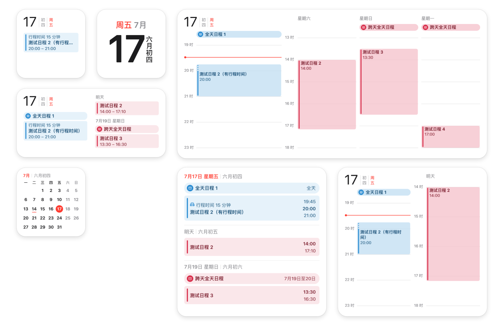

# WinMacCalendar (v1.0.2)

macOS / iPadOS 风格的 Windows 桌面日历小组件，采用 WPF + .NET 9 轻量原生方案构建，通过 CalDAV 协议直连 Apple iCloud 实现双向增量同步。



[查看深色主题预览](图片示例/桌面组件预览-深色.png) · [查看无日程布局](图片示例/桌面组件预览-无日程.png)

---

## 主要特性

- **七种 Apple 风格小组件视图**：
  | 视图 | 基础尺寸 | 网格跨度 | 说明 |
  |---|---:|:---:|---|
  | 月历 | `183 × 183` | `1×1` | 紧凑月历网格、今日红圈、初一红线；支持逐日农历（尺寸恒定不撑大）与可选标记点 |
  | 紧凑摘要 | `183 × 183` | `1×1` | 今日优先，单条完整展示（行程/标题/地点/时间），多条自动降密排布 |
  | 大字日期 | `183 × 183` | `1×1` | 极简大号日期 + 竖排农历 |
  | 双栏摘要 | `395 × 183` | `2×1` | 当天未结束日程优先跨左右两栏排完，余量再按天顺延明天及以后，溢出色条匹配隐藏日程日历色 |
  | 日程列表 | `395 × 395` | `2×2` | 多日完整日程流，含汽车/定位图标、出发与起止时间、首屏智能折叠与滚动查看 |
  | 双日时间线 | `395 × 395` | `2×2` | 今日时间轴 + 行程虚线圆点 + 实时红线；今日后续仍有日程时第 2 列无缝延续今天，否则显示明天 |
  | 四日时间线 | `819 × 395` | `4×2` | 宽屏多日时间轴，同样遵循当天优先延续规则，底部超窗日程显示「其他 N 个日程」 |
- **多小组件 + 矢量缩放 + Apple 网格对齐**：
  - 支持同时在桌面摆放任意多个不同样式的小组件，共享同一份本地缓存与同步引擎；
  - 支持 `60% – 130%` 矢量无损缩放，提供「所有小组件统一大小」开关；
  - 支持以 `#1` 主组件为基准建立 Apple 网格（单元 `183px` + 间距 `29px` = 步距 `212px`，按缩放等比计算），拖动松手自动吸附、缩放保持阵型，并支持在设置页按网格微调或输入精确像素坐标。
- **现代深浅色界面**：
  - 独立前台「设置与布局」窗口、现代圆角右键菜单（含系统托盘右键菜单）、只读日程 Inspector 详情卡片与现代编辑表单，全面适配 Windows 11 深色/浅色主题与原生 DWM 圆角标题栏。
- **iCloud CalDAV 双向增量同步**：
  - 直连 `caldav.icloud.com`（支持区域重定向与多日历发现），使用 Apple ID + App 专用密码，凭证经 Windows DPAPI 仅限当前用户加密存储；
  - 启动即同步 + 每 60 秒 `sync-token` 增量轮询 + 每小时刷新日历元数据，支持离线编辑缓存，版本冲突以 iCloud 服务端为准。
- **自定义本地缓存目录**：
  - 默认存储在 `%LOCALAPPDATA%\WinMacCalendar\calendar.db`，可在「设置 → 常规 → 本地缓存位置」免重启安全热迁移至任意目录或恢复默认。
- **轻量与低内存优化**：
  - 静态复用画刷/控件模板、按需局部重绘、非重复历史 `.ics` 快速预筛与温和工作集整理。

---

## 连接 Apple iCloud 日历（获取 App 专用密码）

由于 Apple 安全策略，第三方 CalDAV 客户端**不能直接使用 Apple 账户主密码**，需先在 Apple 官网生成一个「App 专用密码」（不会影响原账户密码，且随时可单独撤销）。

### 1. 前提条件
- 你的 Apple 账户已开启 **双重认证**（绝大多数账户默认已开启）。
- 在 iPhone / iPad / Mac 的「设置 → Apple 账户 → iCloud」中已开启 **日历** 同步。

### 2. 生成 App 专用密码
1. 浏览器访问 Apple 账户管理页：https://account.apple.com 并登录你的 Apple 账户（登录时需在受信任设备上点击「允许」并输入 6 位验证码）。
2. 进入 **「登录与安全」**（Sign-In and Security）。
3. 点击 **「App 专用密码」**（App-Specific Passwords），再点击 **「生成 App 专用密码」**（或页面中的 `+` 按钮）。
4. 输入便于识别的名称（例如 `WinMacCalendar`），点击 **「创建」**，按提示再次验证 Apple 账户密码。
5. 页面会显示一串 `xxxx-xxxx-xxxx-xxxx` 格式的 16 位专用密码，**立即复制保存**（弹窗关闭后无法再次查看；如忘记，随时可在同一页面撤销并重新生成）。

### 3. 在 WinMacCalendar 中连接
1. 右键桌面小组件（或双击系统托盘图标）打开 **「设置与布局」**。
2. 切换到左侧 **「iCloud 与日历」**，点击 **「连接 iCloud 账户…」**。
3. 填写信息：
   - **Apple 账户邮箱**：输入你的 Apple 账户邮箱（支持主邮箱或 `@icloud.com` 邮箱）。
   - **App 专用密码**：粘贴刚才生成的 `xxxx-xxxx-xxxx-xxxx` 专用密码。
4. 点击 **「验证账户」**，等待拉取云端日历列表后，勾选需要同步的日历并点击 **「保存选择」** 即可。

> **安全与常见提示**
> - 若验证时提示 `401 Unauthorized`，通常是误填了 Apple 账户主密码、专用密码复制不完整或未开启双重认证。
> - App 专用密码仅在本机通过 Windows DPAPI（绑定当前 Windows 用户）加密存储，仅直接与 Apple 官方 CalDAV 服务器通信（自动支持国际区 `icloud.com` 与国区 `icloud.com.cn` 重定向）。

---

## 技术栈与架构

| 层 | 技术 |
|---|---|
| 运行时 | .NET 9.0 (`net9.0-windows`) / C# 12 |
| UI 框架 | WPF + Win32 P/Invoke（桌面底层钉住、DWM 深浅色标题栏与圆角） |
| 本地存储 | SQLite (`Microsoft.Data.Sqlite`) |
| 日历解析与同步 | `Ical.Net` + CalDAV (RFC 4791) 直连 iCloud |
| 凭证安全 | Windows DPAPI (`ProtectedData`, `CurrentUser`) |
| 农历计算 | 离线 `ChineseLunisolarCalendar`（无需网络） |

### 项目结构

```text
WinMacCalendar/
├── WinMacCalendar.csproj        — 项目配置 (.NET 9 WPF, v1.0.2)
├── App.xaml / App.xaml.cs       — 应用入口、单实例检测与自定义缓存路径引导
├── MainWindow.cs                — 主小组件、多组件布局/网格引擎、同步调度与托盘菜单
├── Widget/
│   ├── CalendarCard.cs          — 卡片外框、月历与大字日期、静态模板/画刷缓存
│   ├── AgendaViews.cs           — 紧凑摘要、双栏摘要与日程列表
│   ├── TimelineViews.cs         — 双日/四日时间线与行程圆点绘制
│   ├── WidgetWindow.cs          — 额外桌面小组件窗口与多组件配置模型
│   ├── SettingsWindow.cs        — 现代化独立设置与布局窗口
│   ├── Dialogs.cs               — 只读日程 Inspector、编辑表单、当日日程与 iCloud 连接弹窗
│   └── WidgetFonts.cs           — 内置 SF Pro / PingFang SC 字体加载
├── Themes/
│   ├── ModernStyles.xaml        — 全局深浅色现代圆角控件样式
│   └── ThemeResources.cs        — 双主题调色板与样式静态缓存
├── CalDAV/ICloud.cs             — iCloud CalDAV 发现与双向增量同步
├── Storage/CalendarStore.cs     — SQLite 持久化与零重启热迁移
├── Services/
│   ├── Events.cs                — ICS 预筛、展开（含地点/备注/重复/行程）与写回
│   ├── Dates.cs                 — 农历月日与星期计算
│   ├── CalendarSource.cs        — 日历源与色彩归一化
│   └── Desktop.cs               — Win32 桌面钉住、DWM 外观、开机自启与内存整理
├── Resources/
│   ├── Calendar.ico             — 应用与托盘图标
│   └── Fonts/                   — 精简子集字体（随构建与发布打包）
├── test/fonts/                  — 原始完整字体归档（不打包进程序）
└── tests/                       — 单元测试、视图渲染校验与真实窗口交互测试
```

---

## 设计与隐私原则

1. **桌面钉住**：桌面小组件使用 `WS_EX_TOOLWINDOW` + `ShowActivated = false` + `DWMWA_EXCLUDED_FROM_PEEK`，并动态锚定在系统桌面窗口（`SHELLDLL_DefView` 所属 `Progman`/`WorkerW`）正上方且监听前台/最小化事件：平时严格贴底不遮挡任何软件、不进任务栏/Alt+Tab，点击「显示桌面」（`Win+D`）或速览桌面时仍保持可见，并与系统桌面右键菜单正常互切焦点；设置窗口与日程弹窗为独立普通前台窗口，不受底层小组件层级牵连。
2. **离线可用**：全量 `.ics` 保存在本地 SQLite 中，断网时完整可用；恢复联网后自动推送本地更改。
3. **无第三方通信**：仅直连 Apple iCloud CalDAV 服务器，不经过任何中间服务器；个人日历数据库与加密凭证只存放在本机用户目录，不包含在代码仓库内。
4. **字体策略**：
   - `Resources/Fonts/`（约 3.5 MB）：无损子集化后的 `SF Pro`（数字/拉丁/符号）与 `PingFang SC`（GB2312 全部 6,763 个简体汉字 + 农历/标点），默认随程序打包至 `Fonts/`；极罕见生僻字由系统字体自动补齐。
   - `test/fonts/`：保留原始完整字体用于后续重新生成子集，**不打包进构建或发布产物**。

---

## 构建、测试与发布

在 Windows 项目根目录下执行（未全局安装 .NET 9 SDK 时可使用工作区内的 `.\.dotnet\dotnet.exe`）：

```powershell
# 构建
dotnet build WinMacCalendar.csproj

# 运行完整测试套件（农历、同步模拟、热迁移、7 视图与 1125/1126 对照断言）
dotnet run --project tests/CalendarChecks.csproj

# 运行真实窗口端到端交互测试
dotnet run --project tests/CalendarChecks.csproj -- --desktop
dotnet run --project tests/CalendarChecks.csproj -- --desktop-multi

# 发布 win-x64 自包含版本
dotnet publish WinMacCalendar.csproj -c Release -r win-x64 --self-contained true -o publish/win-x64
```

运行 `publish/win-x64/WinMacCalendar.exe` 即可启动桌面日历。右键卡片或双击系统托盘图标可打开「设置与布局」窗口。

### 自动编译与发布 Release

仓库已内置 GitHub Actions 流水线（[.github/workflows/release.yml](.github/workflows/release.yml)）：

- **推送标签自动发版**：只需打上 `v*` 标签并推送（如 `git tag -a v1.0.3 -m "v1.0.3" && git push origin v1.0.3`），GitHub 云端将自动编译并在 Releases 页面发布：
  - `WinMacCalendar-<tag>-win-x64.zip`（自包含版，开箱即用）
  - `WinMacCalendar-<tag>-win-x64-lite.zip`（轻量框架依赖版，需本机有 .NET 9 Desktop Runtime）
  - `SHA256SUMS.txt`（校验和）
- **手动重新触发**：也可在仓库 **Actions → Build & Release → Run workflow** 中输入已有标签名手动触发打包与附件更新。

### 提交约定

提交信息使用中文，格式为 `类型: 简述`（`feat:` / `fix:` / `refactor:` / `style:` / `docs:`）。
